# **Project 6: Continuous Integration (CI)**

## **1. Project Overview**

This project walks you through a setup of an automated Continuous Integration (CI) Pipeline. It demonstrates how we can automate repetitive tasks to keep the delivery of software updates consistent by using Docker, DockerHub, and GitHub Actions.

### **Objectives:**

- Create a two page website that uses both HTML and CSS (Pulled from Project 5)
- Use Docker to containerize the website.
- Build and test a Docker image on local system.
- Publish the Docker image to DockerHub. 
- Set up GitHub Actions that will automate builds and publishing.
- Use GitHub repo secrets that will store the DockerHub credentials.
- Verify workflow triggers work as intended.

## **2. Tools Used**

| Tool | Role |
| ----------- | ----------- |
| CSS | Website style |
| HTML | Website build |
| Docker | Website containerization |
| Docker Desktop | Run the Docker container locally |
| DockerHub | Host Docker images |
| Git/GitHub | Manage source code |
| GitHub Actions | Automate CI workflow |
| Ubuntu/WSL | Terminal for development |
| VSCode | Text/Markdown Editing |

### **CI Pipeline Diagram:**

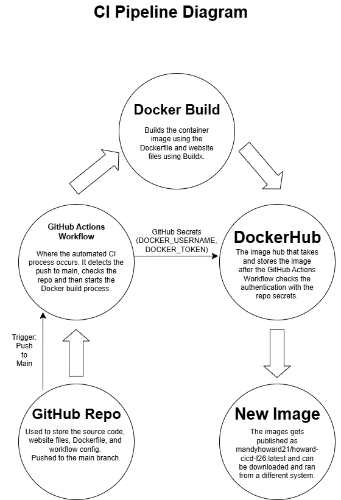

## **3. Docker Configuration**

We will use Docker to contaninerize the website and the Apache HTTP Server Image. This basically just means that we will package all of the code for the website together (with all that it needs to to run) into a single, portable package.

### **Dockerfile:**

Create and save the Dockerfile in `Project6-CI/Dockerfile. (I copied this over from Project 5)

View Dockerfile: [Dockerfile](https://github.com/WSU-kduncan/ceg3120-cicd-howard432-f26/blob/main/Project6-CI/Dockerfile)

```
FROM httpd:2.4 
COPY web-content/ /usr/local/apache2/htdocs/
```
What it means:
*FROM httpd:2.4* - This uses the Apache HTTP Server image as the base.
*COPY web-content/ /usr/local/apache2/htdocs/* - This copies the websites files into the Apache web directory that is inside of the container.

### **Time to Build the Docker Image:**

`docker build -t mandyhoward21/howard-cicd-f26:latest .`

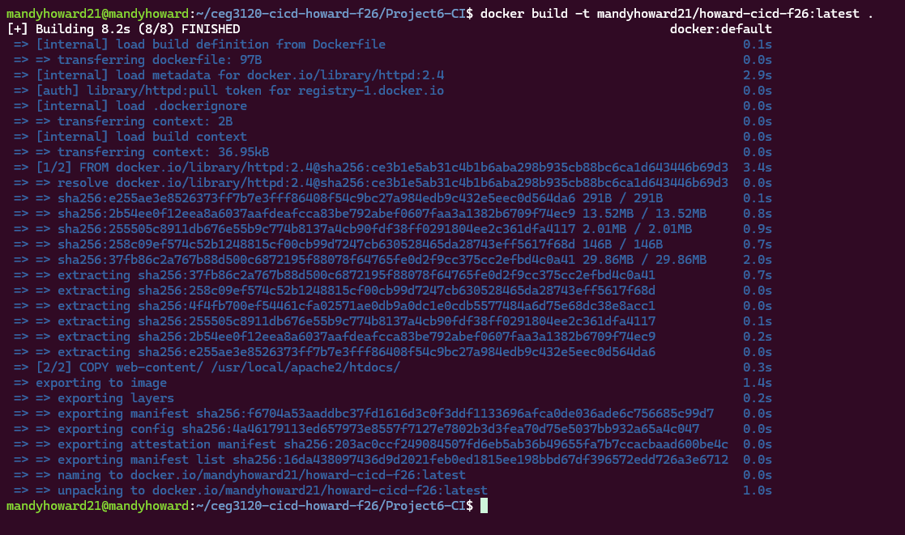

Check to make sure the download to the local system was successful by using: `docker images`

### **Run the container on the local system:**

`docker run -d -p 8080:80 --name howard-cicd-test mandyhoward21/howard-cicd-f26:latest`

This makes the website able to be accessed in a browser.

### **Check to make sure the container is running where it should be:**

`docker ps`

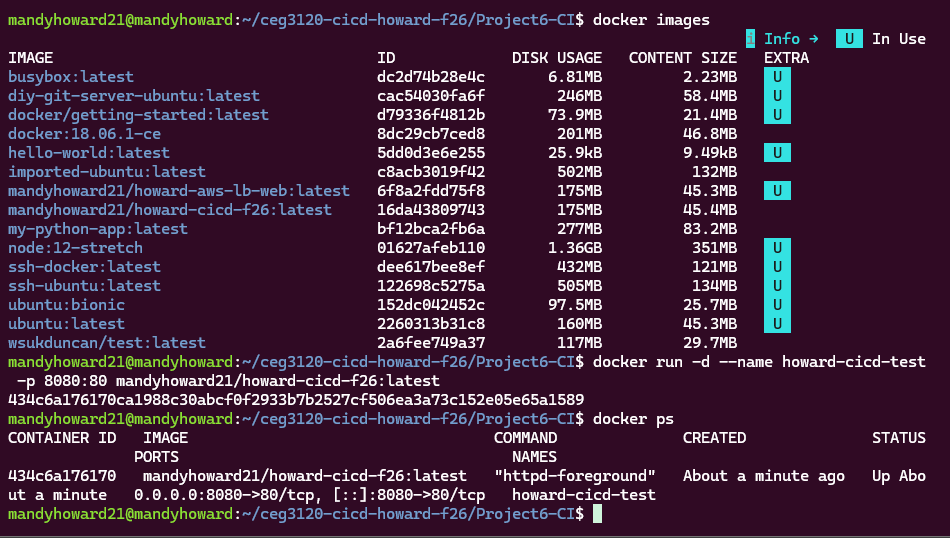

This confirms that it is running on port 8080 on the local system to the port 80, which is inside of the container.

I used Google Chrome to confirm by using the following web addresses:

http://localhost:8080/

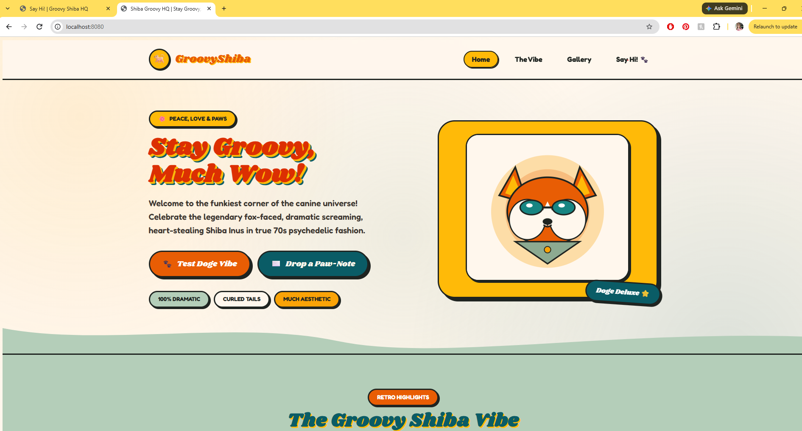

http://localhost:8080/contact.html

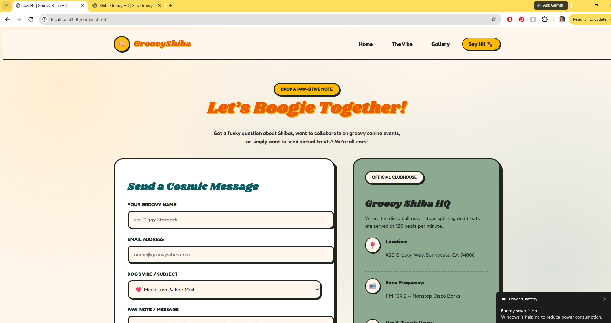

## **4. Publish the Docker Image to DockerHub**

This is done so the image can be accessed remotely, instead of just locally.

Public DockerHub repo: mandyhoward21/howard-cicd-f26

[DockerHub Repo](https://hub.docker.com/r/mandyhoward21/howard-cicd-f26/tags)


First, you will authenticate DockerHub using a Personal Access Token (PAT). From the command line, enter: 

`docker login`

Enter your DockerHub username and PAT when prompted.

*How to find your DockerHub username:* Open DockerDesktop, sign in, click on the profile icon at the top right (Mine shows as a "M")

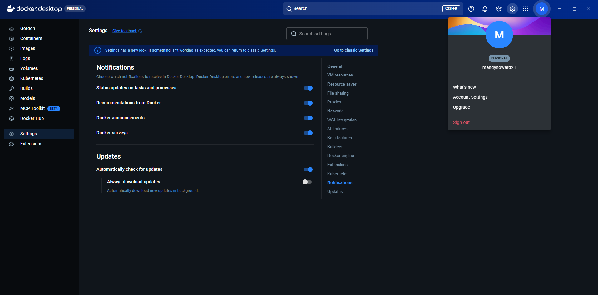

*How to create a PAT:* 
- While you have your profile icon selected, click "Account Settings". 
- Navigate to "Personal access tokens". (It is located on the left sidebar.)
- Generate the token by clicking "Generate new token" at the top right.
- Enter a description that will let you know what this particular token is used for, set your expiration date and access permissions. I set mine to 90 days expiration and "Repo Read, Write, Delete". I selected Allow Cloud Sandbox Access and clicked Generate.

### **Push the Image**

`docker push mandyhoward21/howard-cicd-f26:latest`

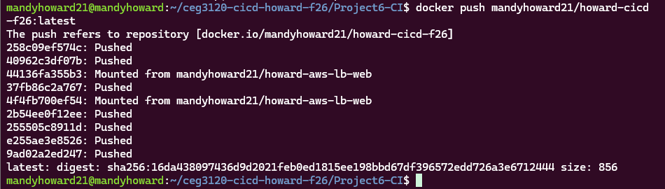

### **Pull and Test Pushed Image**

To make sure the image can be retrieved from DockerHub.

`docker pull mandyhoward21/howard-cicd-f26:latest`

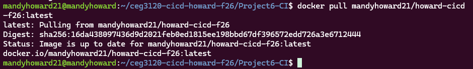

Test by running the downloaded image in a separate container.

`docker run -d -p 8080:80 --name howard-cicd-remote-test mandyhoward21/howard-cicd-f26:latest`

## **5. GitHub Actions for Automated CI Workflow**

Use GitHub actions to automate the Docker Image Build and Push Process so it can be done automatically whenever changes are pushed to the main branch.

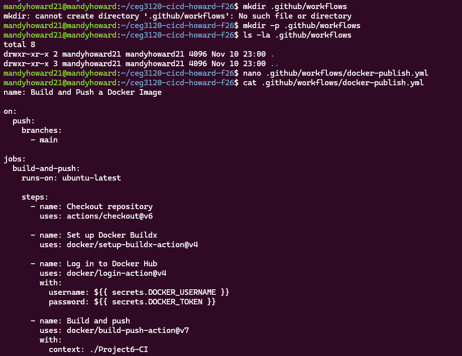

### **Workflow File**

View Workflow File: [Workflow File](https://github.com/WSU-kduncan/ceg3120-cicd-howard432-f26/blob/main/.github/workflows/docker-publish.yml)

### **Workflow Trigger**

A workflow trigger is simply an action that starts the automated process. This particular workflow is triggeredy by a push to the main branch (only).

```
on:  [[Defines what event starts the workflow]]
  push: [[Event=Git push]]
    branches: [[Which branch to watch]]
      - main [[Only pushes to main branch trigger it]]
```

### **Repo Secrets**

Two different GitHub repo secrets were created for this project so we could securely authenticate with DockerHub. These were created in GitHub repo under Settings -> Secrets and Variables -> Actions

Secrets created:

| Secret | Role |
| ----------- | ----------- |
| DOCKER_USERNAME | Used to store the username |
| DOCKER_TOKEN | Used to store the PAT |

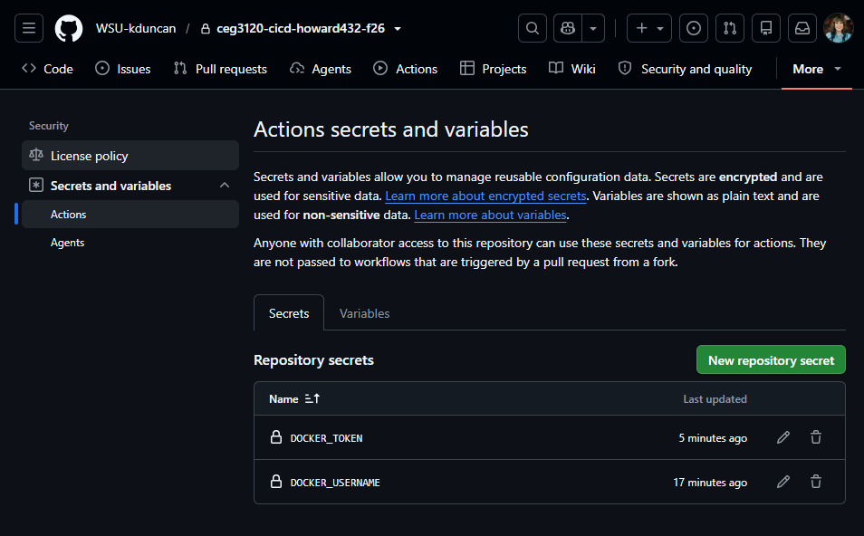

*Note:* The actual username and PAT values are hidden/not stored in the public repo for others to see.

### **Workflow Steps**

1. Gets the files from GitHub.
2. Sets up the Docker build environment.
3. Logs in to DockerHub by authenticating with the repo secrets.
4. Builds the Docker image and pushes it to DockerHub with the `latest` tag.

### **Workflow Image Config**

This is what tells the GitHub Actions where to find the Dockerfile, to push the image and the tag that it should use.

```
context: ./Project6-CI
push: true
tags: mandyhoward21/howard-cicd-f26:latest
```
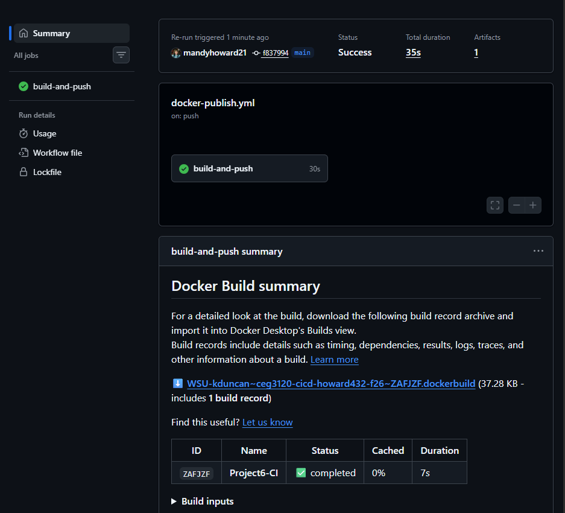

### **Test on Non-Main Branch**

Test to make sure the workflow action does not run when on a different branch than main.

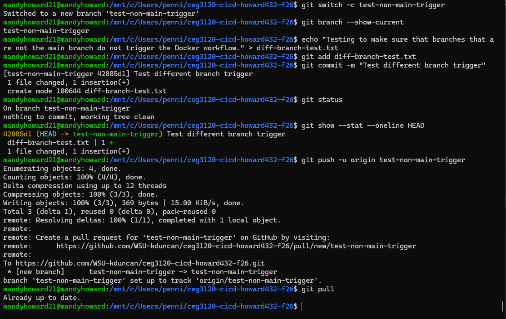

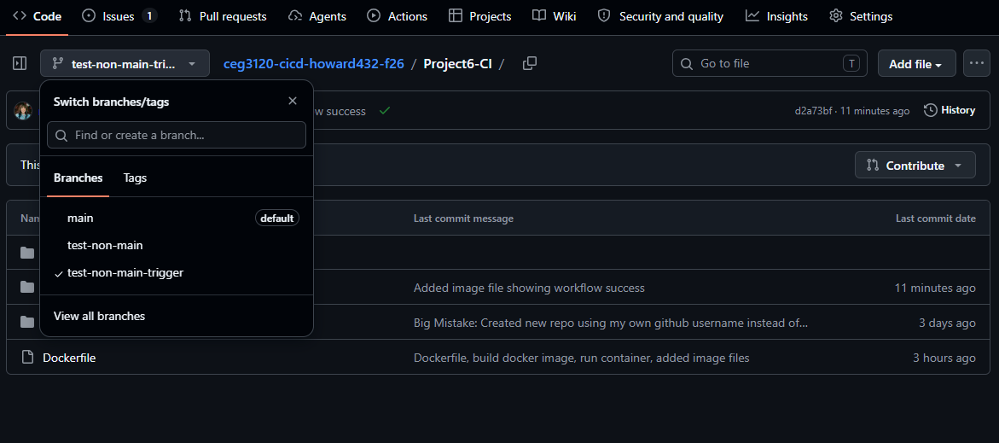

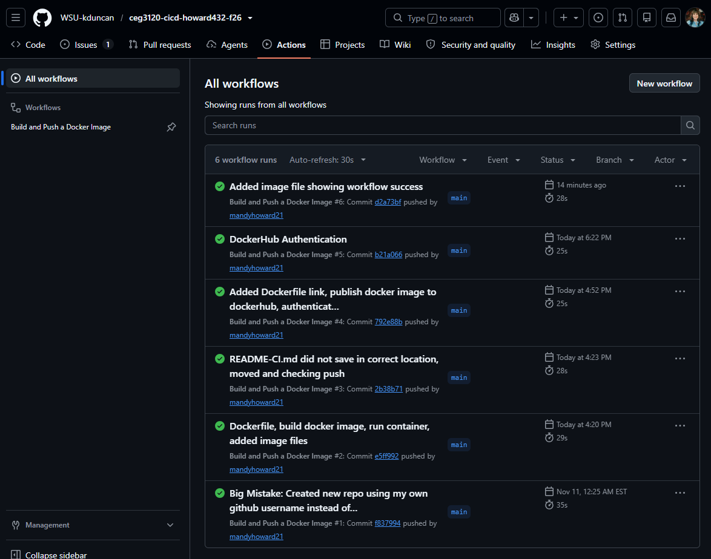

## **6. Semantic Versioning**

### **Overview:**

We will build another GitHub action workflow that pushes versioned Docker images when a tag is created. This will help someone download a specific version of our website instead of always just downloading the newest one.

### **Objectives:**

- Create a separate release workflow.
- Make the workflow to where it only triggers when a Git tag is pushed.
- Use Docker Metadata Action to create the image tags.
- Push two different versions of the image.
- Check the tags and run a test that will take you back to an earlier version.

### **Step 1. Create the workflow file**

Open up a text editor that will house the new workflow file.

`nano .github/workflows/docker-release.yml`

I copied the original docker-publish.yml and made some changes:

| Feature | Original: docker-publish.yml | New: docker-release.yml |
| ----------- | ----------- | ----------- |
| Name | Build and Push a Docker Image | Build and Push Versioned Docker Image |
| Purpose | CI | Versioned releases |
| Trigger | Push to main | Push a Git tag |
| Trigger Ex. | `git push` to main | `git push origin v1.0.0` |
| Docker image | `:latest` | `:1.0.0, :1.0, :1`, etc. |
| Docker metadata action | No | Yes |
| Build and Push | Yes | Yes |

*Added:* Generate Docker metadata, tags for verison, major, minor. 

### **Step 2. Config Docker Metadata**

This action creates Docker image tags automatically based on the Git version tag. For this project we created a tag that points to the latest release, 1 shows the latest release in V1, and then 1.0 or 1.1 shows latest relase for major and minor versions.

```
tags: | 
  type=raw,value=latest
  type=semver,pattern={{major}}
  type=semver,pattern={{major}}.{{minor}}
  ```

### **Step 3. Create and push V1.0.0**

```
git tag -a v1.0.0 -m "Release version 1.0.0"
git push origin v1.0.0
```

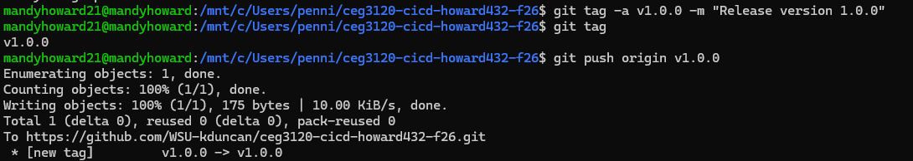

This is what triggers the versioned release workflow. 

### **Step 4. Create and push V1.1.0**

```
git tag -a v1.1.0 -m "Release version 1.1.0"
git push origin v1.1.0
```

### **Step 5. Check DockerHub Tags**

Check the Tags page to make sure the new release didn't overwrite the minor version.

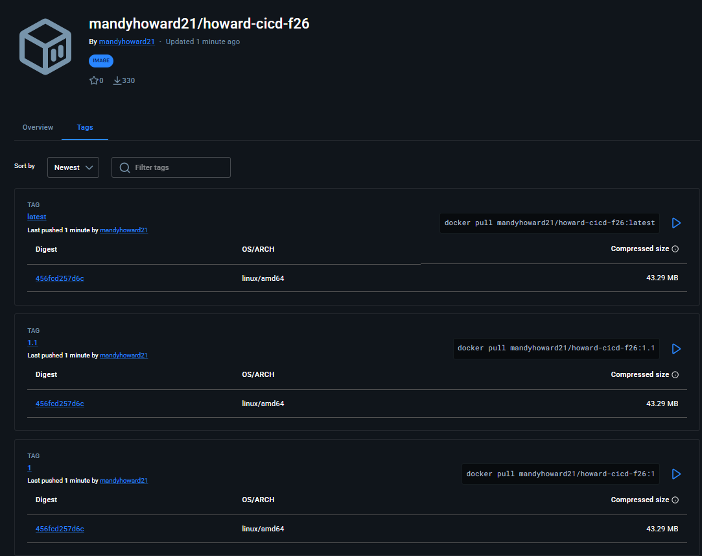

### **Step 6. Test the rollbacks**

`docker run -d -p 8080:80 --name rollback-v1 mandyhoward21/howard-cicd-f26:1.0`

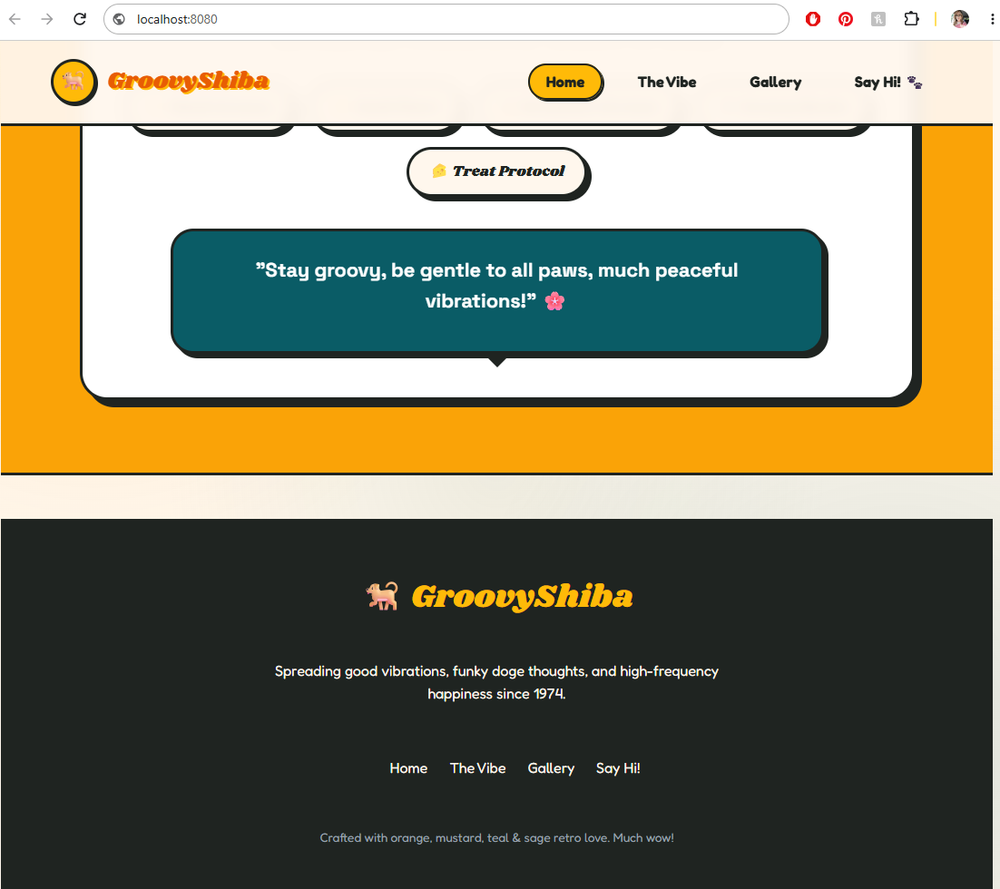

The website loaded without the version announcement successfully.

`docker run -d -p 8080:80 --name rollback-v2 mandyhoward21/howard-cicd-f26:1.1`

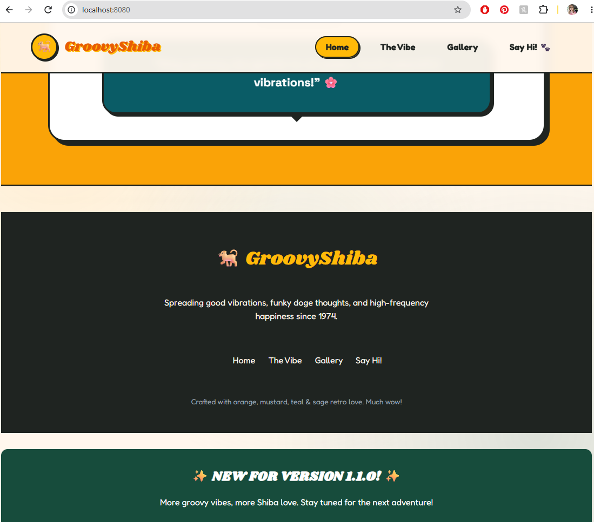

The website showed the version 1.1.0 announcement successfully.

### **Step 7. Test the Release Workflow Trigger**
 
- Pushed a commit to the main branch without creating a git tag.
- Original CI workflow ran as it should and the versioned workflow did not run (which is what we wanted!)

View Versioned Workflow File: [Versioned](https://github.com/WSU-kduncan/ceg3120-cicd-howard432-f26/blob/main/.github/workflows/docker-release.yml)


Sources:

Source: Introduction GitHub Actions - hello-world demo (https://www.telerik.com/blogs/introduction-github-actions)
Accessed: Hello World GitHub Actions - practice

Source: GitHub Actions - DockerHub documentation (https://docs.docker.com/build/ci/github-actions/)
Accessed: Docker Build GitHub Actions - Docker BuildX info, Build and push Docker images, configuring repo with secrets, setting up Actions workflow

Source: Markdown Cheat Sheet (https://www.markdownguide.org/cheat-sheet/)
Accessed: Markdown Syntax 

Source: GitHub Docs-Triggering a workflow (https://docs.github.com/en/actions/how-tos/write-workflows/choose-when-workflows-run/trigger-a-workflow)
Accessed: Breakdown of the parts of Triggering a Workflow

Source: Semantic Versioning 2.0.0 (semver.org)
Accessed: Semantic versioning best practives

Source: Gemini Prompt "Write html code for the website you created for me that will show the Version"
Response: Insert this immediately above </body>:
  <div style="background-color: #174C3C; color: white; text-align: center; padding: 18px; margin-top: 30px; border-radius: 12px;">
    <h2>✨ NEW FOR VERSION 1.1.0! ✨</h2>
    <p>More groovy vibes, more Shiba love. Stay tuned for the next adventure!</p>
  </div>

Source: Gemini Prompt "Check this markdown file for any spelling or syntax errors"
Response: Had a few images that were missing .png, a couple of spelling errors, and a duplicate image tag.

ORIGINALLY CREATED REPO HERE: https://github.com/mandyhoward21/ceg3120-cicd-howard-f26


